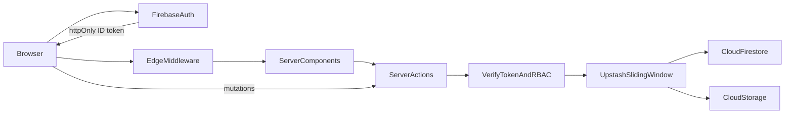

# NotesBucket

All your notes in one place.

Live app: [notesbucket.pl](https://notesbucket.pl)

## Overview

NotesBucket is a full-stack, approval-gated knowledge base. An admin writes Markdown notes in a VS Code-grade editor with Vim mode and organizes them in a nested folder tree. Approved users browse those notes by category and school subject. The interface is in Polish, built for a Polish student audience.

I designed it, built the frontend and backend, put the access control in place, and deployed it to production on [notesbucket.pl](https://notesbucket.pl).

## Features

### For readers

- Sign in with Google. A new account starts as `unverified` and has no access to notes.
- Onboarding asks for a real first and last name, then holds the user in a waiting room until an admin approves the account.
- Browse a nested folder tree filtered by category (Programming, School, Other) and, for school notes, by subject.
- Read notes rendered as GitHub-Flavored Markdown, with tables, task lists, and images.
- Copy a note to the clipboard or download it as a `.md` file.
- Each note sets its own document title through `generateMetadata`.

### For the admin

- Create, rename, and delete notes and nested folders. Folder and note names are capped at 48 characters.
- Move a note into another folder from a dialog that reuses the same folder tree.
- Edit Markdown in Monaco Editor (the editor inside VS Code), themed `vs-dark`, with `monaco-vim` and a custom `kj` mapping that leaves insert mode.
- Save with Ctrl/Cmd+S, autosave every 15 minutes, and save again when the editor unmounts.
- Upload images by drag-and-drop or file picker (3 MB, images only) from a side panel. Each image is named, stored in Firebase Storage, and made public.
- On save, `` references are matched to uploaded images by name and rewritten to the current Storage URL.
- Promote a user to `verified` or `admin`, demote a non-admin, or delete the account. An existing admin's role can only be changed from the Firebase console.

## Technical decisions

### Server Actions as the API

Every mutation and privileged read lives in a `"use server"` module: `lib/notes.ts`, `lib/folders.ts`, `lib/users.ts`, `lib/notesImages.ts`. The client calls typed functions directly, so there is no separate REST layer to keep in sync with the UI. After a write, `revalidatePath` invalidates the affected route.

### Two-layer authentication

Firebase Auth issues the ID token on the client. `onIdTokenChanged` in `UserContext` refreshes it and stores it in an `httpOnly` cookie, so page JavaScript cannot read it.

The Edge middleware on `/notes` and `/users` decodes that cookie with `jose` and rejects missing or expired tokens before the page renders. That check is intentionally cheap. Server Actions that gate access verify the token with `firebase-admin` `verifyIdToken`, and that verification is what authorizes the request.

### Role-based access, including ownership

Users have one of three roles: `unverified`, `verified`, or `admin`. A single guard, `checkIfAuthorized(roles, ownerAccess, ownerId)`, covers both cases: role membership, and the case where a user may touch only their own document (profile completion). Reading notes requires `verified` or `admin`. Creating and editing notes, folders, and images, and managing users, requires `admin`. `setUserRole` refuses to change anyone who is already an admin, so that role cannot be taken away from inside the app.

### Rate limiting on every Server Action

Each action starts with a sliding-window limit on Upstash Redis: 40 requests per 20 seconds, keyed by the `x-forwarded-for` IP. A rejected caller is redirected to a dedicated too-many-requests page. Failed authentication also counts against the limit, so repeated bad tokens are throttled the same way.

### Writes stay on the Admin SDK

Creates, updates, and deletes from the app go through `firebase-admin` inside Server Actions, so the Admin SDK credentials stay on the server. The client SDK only reads folder documents, and it does that as the tree expands.

### Schema-first data model

Zod schemas in `lib/dbSchemas.ts` are the source of the TypeScript types via `z.infer`, and folder documents are parsed with `FolderSchema` when they are read. The same schemas encode the constraints: names up to 48 characters, note bodies up to 10,000 characters, and image names of 3–24 characters. Firestore `DocumentReference` values are converted to plain ids in `lib/serializing.ts` before they cross to the client, so Server Component props stay serializable.

### A folder tree that stays cheap to open

Folders are stored as an adjacency list: each document points at its parent. `getAllFolders` rebuilds the tree in a single pass with a `Map`. The notes layout only fetches root folders on the server. Subfolders and the notes inside a folder load when that folder is expanded, which is what keeps the first paint of `/notes` small.

### Server Components, with client islands where they earn their place

Note pages are async Server Components. `getNoteById` is wrapped in React `cache()`, so `generateMetadata` and the page share one Firestore read per request. Monaco is loaded with `next/dynamic` and `ssr: false`, because the editor touches `window` and is only needed on the edit route.

### Images go through a Server Action

The dropzone reads the file, base64-encodes it, and hands it to `addNoteImage`. The action writes the bytes to Cloud Storage, stores the public URL and the storage file name on a `notesImages` document linked to the note, and revalidates the edit page. Replacing or deleting an image updates both Storage and Firestore.

### Shared UI behavior

Destructive actions (delete a note, folder, or user) go through one `ConfirmDialogProvider`, so every confirm dialog behaves the same way. Success and failure surface as Sonner toasts. Form controls, dialogs, sheets, and selects come from shadcn/ui on Radix primitives.

### Production hosting

The app runs on Firebase App Hosting. Public config is declared in `apphosting.yaml`. The Firebase private key, the Upstash token, and the revalidation secret are referenced from Cloud Secret Manager and are not committed.

## Architecture

## Tech stack

**Frontend**

- Next.js 15 App Router and React 19
- TypeScript
- Tailwind CSS, with the typography and scrollbar plugins
- shadcn/ui and Radix UI
- React Hook Form for the category and subject filters, and Zod for the data schemas
- Monaco Editor and monaco-vim
- react-markdown and remark-gfm
- react-dropzone
- Sonner
- Ubuntu and Ubuntu Mono through `next/font`

**Backend**

- Next.js Server Actions
- Edge Middleware
- Firebase Admin SDK
- `jose`, for the edge token decode

**Data and infrastructure**

- Firebase Authentication with the Google provider
- Cloud Firestore
- Cloud Storage for Firebase
- Upstash Redis
- Firebase App Hosting
- Cloud Secret Manager

**Design and tooling**

- Figma for the mockups
- Inkscape for the SVG logo
- ESLint
- Turbopack for local development

## Data model

| Collection | What it stores |
| --- | --- |
| `users` | Google uid, email, first and last name, role (`unverified`, `verified`, `admin`), creation date |
| `folders` | Name, parent reference, category, and an optional school subject |
| `notes` | Title, Markdown body, parent folder reference |
| `notesImages` | Display name, public URL, Storage file name, and a reference back to the note |

## Role

Solo project. I owned the product design, the UI, the data model, authentication and authorization, rate limiting, and the production deployment.
